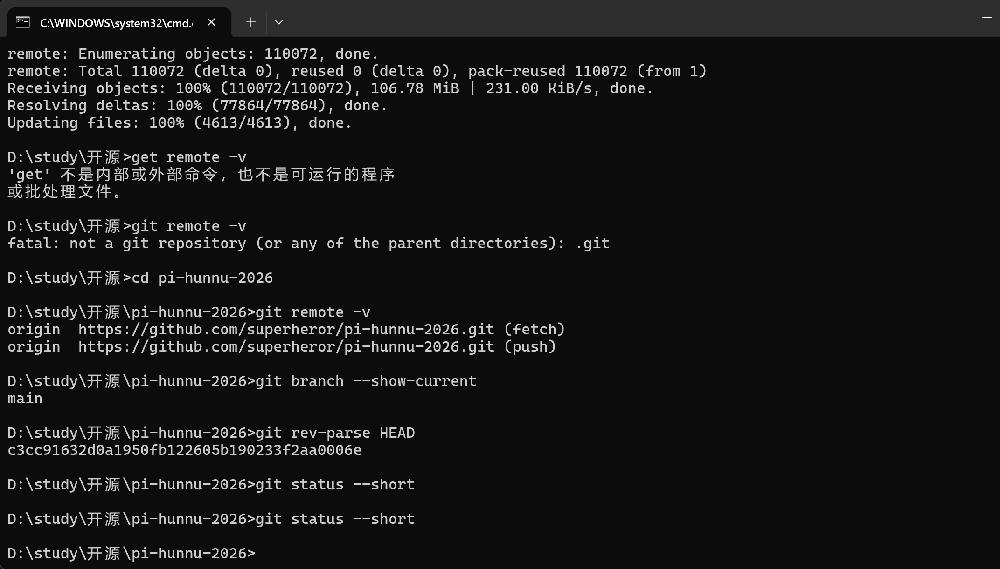
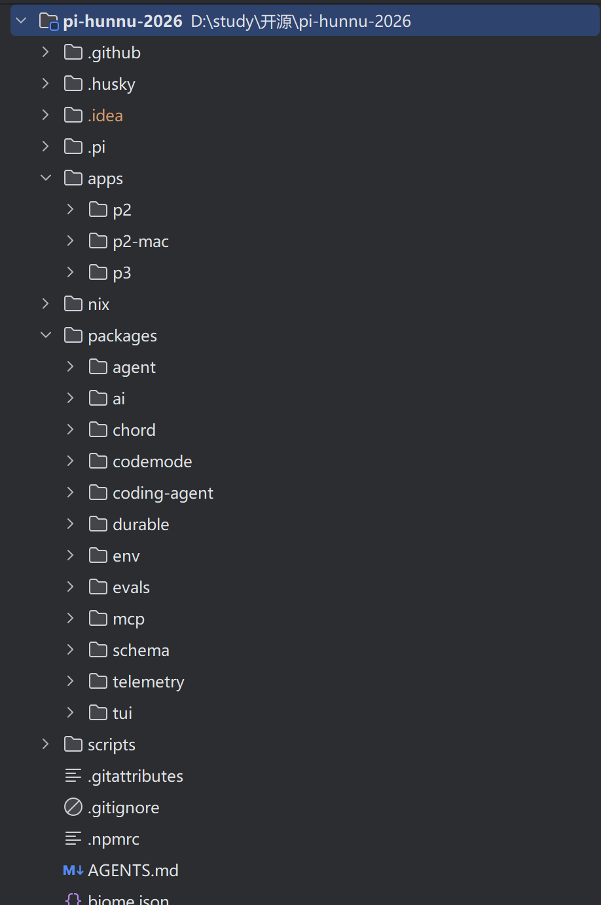
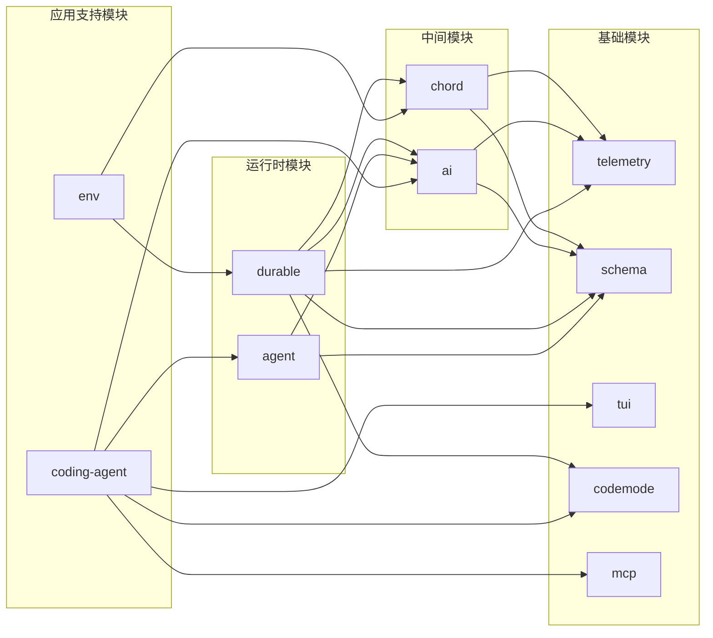

# 实践课 2：组织建仓与 Pi Agent 源码分析

> 姓名：阳凌杰（Yang Lingjie）。
>
> 学号：202430224046
>
> 个人作业仓库：https://github.com/3524967016ylj-jpg/Pi-Agent-Practice-2

**分析对象**：小组仓库 `superheror/pi-hunnu-2026`，本地 `main` 分支提交 `c3cc91632d0a1950fb122605b190233f2aa0006e`。下文的目录、脚本和依赖均以这个提交为准。**重点分析模块**：`telemetry`、`ai`、`coding-agent`。

## 一、源码获取与目录

- 小组代码仓库（本地 `origin`）：https://github.com/superheror/pi-hunnu-2026.git
- 本地目录：`D:\study\开源\pi-hunnu-2026`
- 分支：`main`
- 完整提交号：`c3cc91632d0a1950fb122605b190233f2aa0006e`
- 检查时 `git status --short` 无输出，工作区干净。
- 组织仓库截图：显示 `superheror/pi-hunnu-2026` 从课程仓库 fork；`superheror` 是 Organization。
- S1 本地仓库信息截图：后半部显示正确目录中的 `origin`、`main`、完整提交号和无输出的 `git status --short`。前半部的命令报错发生在进入仓库之前，不作为结果。
- 源码目录截图：显示本地仓库以及展开的 `packages`、`apps`。

### 目录如何组织

这里采用 **monorepo**：一个 Git 仓库同时管理多个相互配合的包和应用。根目录 `package.json` 的 `workspaces` 声明了 `packages/*`、`apps/*` 和几个示例项目；npm 因此能在仓库根目录管理这些子项目。`packages` 放可复用模块，`apps` 放具体应用（本版本为 `p2`、`p2-mac`、`p3`），`scripts` 放构建、检查等仓库级脚本。各模块有自己的 `package.json`，因此拥有自己的名称、依赖和 `build` 命令；根脚本再把它们串起来。

本地 `packages` 还包含 `evals`，但老师列出的分析对象是另外 11 个模块。这里将 `evals` 作为版本差异记录，不擅自把它加入指定模块的构建顺序。依据：根目录 `package.json` 的 `workspaces`、`scripts.build` 与源码目录截图。

## 二、构建顺序与模块分析

根目录 `package.json` 的 `scripts.build` 指定顺序：

`telemetry → schema → chord → tui → codemode → mcp → ai → durable → env → agent → coding-agent`

表中“直接依赖”只计入本模块 `package.json` 的 `dependencies` 中声明的**内部包**。例如 `ai` 的 `openai` 是外部依赖，不画进内部模块图；测试工具 `vitest` 位于 `devDependencies`，也不画成运行依赖。除特别说明外，`build` 运行 `tsc -p tsconfig.build.json`：模块配置指定 `src` 为输入、`dist` 为输出，并继承根 `tsconfig.base.json`。根配置启用了 `declaration`、`declarationMap`、`sourceMap`，因此通常产生 JavaScript、类型声明及其映射文件。下面的“产物”是**脚本与配置规定的结果**，不等于本报告实际执行过完整构建。

| 模块 | 主要功能 | 本模块 build 做什么、生成什么 | 直接依赖的内部模块 | 依据 |
|---|---|---|---|---|
| `telemetry` | 为其他包提供与具体监控平台无关的运行记录接口：`TelemetryContext` 开始 span，事件和指标记录执行过程；还提供空实现、内存实现。它定义“怎么记录”，不负责把数据导出到某个平台。 | `tsc` 编译 `src` 到 `dist`。 | 无 | `packages/telemetry/README.md` 开头；`src/index.ts` 的接口；`package.json`、`tsconfig.build.json` |
| `schema` | 构造 JSON Schema 并将其编译成校验函数，用于检查运行时数据是否符合约定；实现不依赖 `eval`。 | `tsc` 编译到 `dist`。 | 无 | `packages/schema/README.md` 开头；`src/builders.ts`、`src/compiler.ts`；`package.json` |
| `chord` | 跨服务器、worker 和浏览器进程管理对象契约、引用、文档与连接；插件可在运行中重载。对象契约需要 schema 描述，执行过程可用 telemetry 记录。 | `tsc` 编译到 `dist`。 | `schema`、`telemetry` | `packages/chord/README.md` 的概念介绍；`package.json` 的 `dependencies` |
| `tui` | 提供终端界面的输入、编辑器、文本和布局组件；差量渲染只更新变化的内容，降低闪烁。 | 默认 `build` 用 `tsc` 输出 `dist`；平台原生构建有单独的 `build:native:*` 脚本。 | 无 | `packages/tui/README.md` 的 Features；`package.json` 的脚本 |
| `codemode` | 在 QuickJS/WASM 环境执行模型生成的 JavaScript；脚本只能使用显式注入的工具能力。 | `tsc` 编译到 `dist`。 | 无 | `packages/codemode/README.md` 开头；`package.json` |
| `mcp` | 实现独立的 MCP 客户端，支持传输无关的客户端核心及 stdio、Streamable HTTP 等连接方式。 | `tsc` 编译到 `dist`。 | 无 | `packages/mcp/README.md` 开头；`package.json` |
| `ai` | 统一不同模型服务的调用接口，管理供应商、模型目录、认证、流式输出、token 和费用信息；用 schema 校验数据，用 telemetry 记录调用。 | `build` 先运行 `generate-models`，再进入 `build:offline`：检查模型数据、`tsc` 编译到 `dist`，清理并复制 `providers/data` 到 `dist/providers`。 | `schema`、`telemetry` | `packages/ai/README.md` 开头；`package.json` 的 `build`、`build:offline`、`dependencies` |
| `durable` | 将会话、模型轮次、工具调用和状态持久化，进程中断后可从存储恢复；组合 Chord 的文档能力和 AI 模型访问。 | `tsc` 编译到 `dist`；`tsconfig.build.json` 中的 `paths` 指向已构建的 `chord`、`ai` 声明。 | `chord`、`ai`、`codemode`、`schema`、`telemetry` | `packages/durable/README.md` 开头；`package.json`；`tsconfig.build.json` |
| `env` | 让 Durable 的工具在远程机器运行：本地客户端经 SSH 联系远端守护进程，远端执行文件与命令操作。 | 默认 `build` 仅用 `tsc` 编译 TypeScript 到 `dist`；Rust 守护进程需单独运行 `build:daemon`。 | `chord`、`durable` | `packages/env/README.md` 开头；`package.json` 的两个 build 脚本 |
| `agent` | 基于 `ai` 组织有状态的 agent 循环，负责消息状态、工具执行与事件流。 | `tsc` 编译到 `dist`；构建配置引用 `ai/dist` 的声明。 | `ai`、`schema` | `packages/agent/README.md` 开头；`src/agent-loop.ts`；`package.json`；`tsconfig.build.json` |
| `coding-agent` | 面向用户的编程助手 CLI，组织交互界面、会话及读文件、编辑、写入、命令等工具；通过 agent 和 ai 完成模型驱动的工作。 | 先执行 `build:unbundled`：`tsc` 编译、标记 CLI/RPC 入口可执行、复制主题和 HTML 导出资源；再运行打包脚本，生成 `dist/bundle` 中的启动文件等。 | `agent`、`ai`、`codemode`、`mcp`、`tui` | `packages/coding-agent/README.md`；`package.json` 的构建脚本与 `dependencies`；`scripts/build-coding-agent-bundle.mjs` |

## 三、模块层级与依赖图

可编辑图源：[模块依赖图.mmd](模块依赖图.mmd)。图中统一用**使用方 → 被依赖方**，每条边都来自使用方 `package.json` 的 `dependencies`。层级按“是否依赖其他内部包”划分：`telemetry`、`schema`、`tui`、`codemode`、`mcp` 是基础模块；`chord` 和 `ai` 建立在基础模块上；`durable`、`agent` 组合更多能力；`env` 和 `coding-agent` 分别服务远程执行与最终 CLI。层级是为了帮助阅读，**不是构建脚本的逐行分组**。图中没有开发依赖或仅由多步传递得到的间接依赖。例如 `coding-agent → agent → schema` 中，`coding-agent` 没有因这条路径而自动增加一条指向 `schema` 的直接边。

## 四、三个问题

### 1. 根目录与子模块的 `npm run build` 分别做什么？

`npm run build` 总是先读取**当前目录的 `package.json`**。在仓库根目录执行时，npm 找到根 `scripts.build`：脚本先进入 `packages/telemetry` 执行它的 `npm run build`，再进入 `schema`，依次处理 11 个模块。命令之间用 `&&` 串联，所以前一个失败时，后面的步骤不会继续。这是一个显式写出的顺序，不是 npm 根据工作区声明自动推导出的顺序。根 `workspaces` 说明哪些目录是工作区，但这里的构建顺序由 `scripts.build` 文字本身决定。

在某个子模块目录执行时，npm 读取**该模块**的 `package.json`，工作因模块而异。大多数模块执行 `tsc -p tsconfig.build.json`：TypeScript 读取该模块配置，并继承根 `tsconfig.base.json`；`rootDir` 是 `src`、`outDir` 是 `dist`，根配置还要求输出类型声明与映射。因此“构建该模块”主要是把源码变成可供其他模块导入的发布文件，并非启动程序或运行测试。`ai` 多了模型目录生成、数据检查和供应商数据复制；`coding-agent` 多了资源复制、入口处理和打包。`env` 的默认 `build` 不包含 Rust 守护进程编译，后者在 `build:daemon` 中。依据：根及各模块 `package.json`、`tsconfig.build.json`、根 `tsconfig.base.json`。

### 2. 构建顺序与依赖有什么关系？相邻模块一定互相依赖吗？

构建顺序必须照顾依赖：如果模块 B 在编译时读取模块 A 的 `dist` 类型文件，通常要先构建 A。源码中有明确例子：`durable/tsconfig.build.json` 把 `@earendil-works/chord`、`@earendil-works/pi-ai` 等映射到 `../chord/dist/...`、`../ai/dist/...`，所以根脚本把 `chord`、`ai` 排在 `durable` 前面。`agent` 的构建配置也引用 `ai/dist`，`coding-agent` 的构建配置引用 `agent/dist`、`ai/dist`、`tui/dist`，对应的构建先后同样合理。

但**“排在前后”不等于“互相依赖”**。根脚本先构建 `telemetry` 再构建 `schema`，两者的 `dependencies` 均无内部包；`tui` 后紧接着 `codemode`，它们也没有直接依赖。一个总构建顺序必须把所有模块排成一列，因此会给相互独立的模块安排先后；依赖图只表示其中有证据支持的直接使用关系。判断依赖时应看各模块 `package.json` 的内部包声明，而不能只看脚本中的相邻位置。

### 3. 至少三个模块的依赖路径及分工

选择四个模块的路径：**`coding-agent → agent → ai → schema`**。

1. `coding-agent` 是用户入口：命令行界面接收任务，管理会话和文件操作等工具。它的 `dependencies` 声明了 `@earendil-works/pi-agent-core`，因此第一条箭头成立。
2. `agent` 管理对话状态、工具执行和事件流，把与模型交互的工作交给统一 AI 层。它的 `dependencies` 声明 `@earendil-works/pi-ai`，因此第二条箭头成立。
3. `ai` 把不同模型供应商的接口整理成统一调用方式，并处理模型目录、响应和工具参数等数据。它的 `dependencies` 声明 `@earendil-works/pi-schema`，因此第三条箭头成立。
4. `schema` 是更底层的数据校验能力：用 JSON Schema 描述数据形状并在运行时检查。它的 `dependencies` 没有内部包。

例如用户在 CLI 中发起一次任务时，入口由 `coding-agent` 接收，`agent` 推进一轮工作，`ai` 与选定的模型服务交互，数据校验能力由底层 `schema` 提供。这个例子说明分工；它**不表示每次模型请求都会逐个调用这四个模块的同名函数**。路径的直接依赖依据是上述三个使用方各自的 `package.json`，功能依据是对应模块的 `README.md` 与源码入口。

