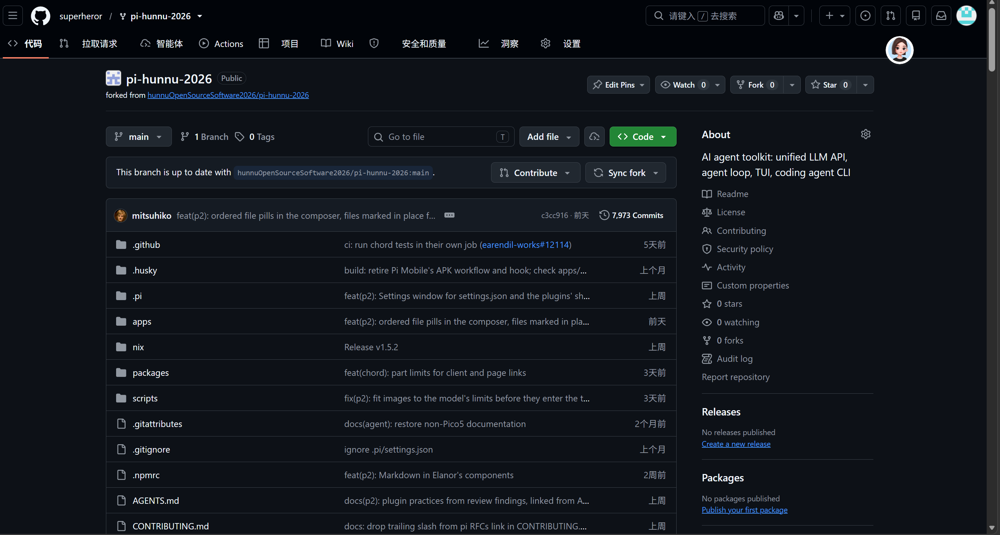
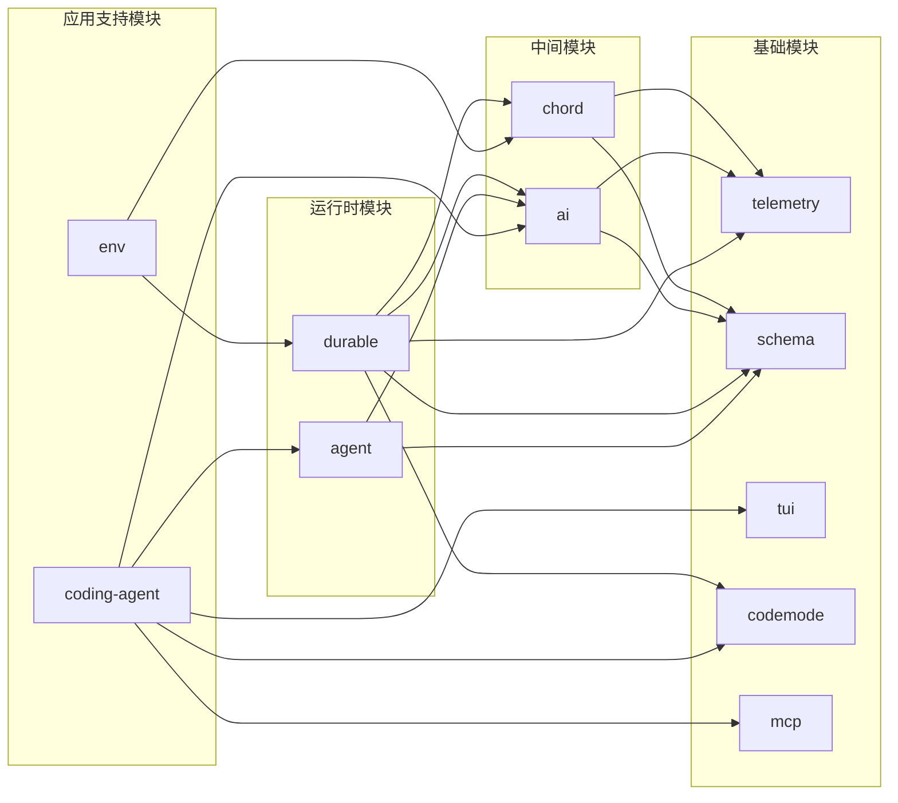

# 实践课 2：组织建仓与 Pi Agent 源码分析——阳凌杰

> 姓名：阳凌杰（Yang Lingjie）。个人作业仓库：https://github.com/3524967016ylj-jpg/Pi-Agent-Practice-2 。本报告依据本地仓库 `D:\study\开源\pi-hunnu-2026` 的 `main` 分支、提交 `c3cc91632d0a1950fb122605b190233f2aa0006e` 编写。本人重点复核的模块：`telemetry`、`ai`、`coding-agent`。

## 一、源码获取与目录

- 小组代码仓库（本地 `origin`）：https://github.com/superheror/pi-hunnu-2026.git
- 本地目录：`D:\study\开源\pi-hunnu-2026`
- 分支：`main`
- 完整提交号：`c3cc91632d0a1950fb122605b190233f2aa0006e`
- 检查时 `git status --short` 无输出，工作区干净。
- 组织仓库截图：见下图。截图显示 `superheror/pi-hunnu-2026` 是从课程仓库 fork 的；GitHub 公共账号信息显示 `superheror` 的类型为 Organization。
- 本地仓库信息截图 S1：见下图。截图前半部有误输入和在上级目录执行命令的报错，后半部在正确仓库目录给出了有效的 `origin`、`main`、完整提交号及空白状态输出。
- 源码目录截图：见下图。

本仓库是 monorepo，即一个仓库管理多个相关包和应用。根目录 `package.json` 的 `workspaces` 包含 `packages/*`、`apps/*` 及若干示例目录。`packages` 存放可复用的库，`apps` 存放应用（本版本有 `p2`、`p2-mac`、`p3`）；`scripts` 存放仓库级脚本。实际 `packages` 还包含 `evals`，它不在题目指定的 11 个模块之列。依据：根目录 `package.json` 的 `workspaces` 和目录截图。

## 二、构建顺序与模块分析

根目录 `package.json` 的 `scripts.build` 指定顺序：

`telemetry → schema → chord → tui → codemode → mcp → ai → durable → env → agent → coding-agent`

下表“直接依赖”仅统计各模块 `package.json` 的 `dependencies` 中声明的**内部包**，不把外部 npm 包或测试用的 `devDependencies` 混入。除特别说明外，模块的 `build` 都执行 `tsc -p tsconfig.build.json`，读取该模块的 `tsconfig.build.json`（它继承根目录 `tsconfig.base.json`），把 `src` 编译到本模块 `dist`，生成 JavaScript 和类型声明。这个输出判断依据是各模块构建配置及根 TypeScript 配置。

| 模块 | 主要功能 | 本模块 build 做什么、生成什么 | 直接依赖的内部模块 | 依据 |
|---|---|---|---|---|
| `telemetry` | 定义运行记录、跨度、事件和指标的通用接口，提供空实现与内存实现 | 常规 TypeScript 编译到 `dist` | 无 | `packages/telemetry/README.md`、`src/index.ts`、`package.json` |
| `schema` | 构造和校验 JSON Schema，把规则编译成校验函数 | 常规 TypeScript 编译到 `dist` | 无 | `packages/schema/README.md`、`src/compiler.ts`、`package.json` |
| `chord` | 跨进程对象运行时，管理对象契约、文档、存储和连接等 | 常规 TypeScript 编译到 `dist` | `schema`、`telemetry` | `packages/chord/README.md`、`package.json` |
| `tui` | 终端界面组件与差量渲染，供交互式命令行使用 | 常规 TypeScript 编译到 `dist`；原生平台构建是另设脚本 | 无 | `packages/tui/README.md`、`package.json`、`tsconfig.build.json` |
| `codemode` | 在受限 QuickJS 环境中运行模型编写的 JavaScript，通过注入工具提供能力 | 常规 TypeScript 编译到 `dist` | 无 | `packages/codemode/README.md`、`package.json` |
| `mcp` | 提供独立的 MCP 客户端及 stdio、HTTP 等传输方式 | 常规 TypeScript 编译到 `dist` | 无 | `packages/mcp/README.md`、`package.json` |
| `ai` | 统一模型调用、供应商适配、模型目录与用量处理 | 先生成模型数据，再检查模型数据、编译到 `dist`，并复制供应商数据到 `dist/providers` | `schema`、`telemetry` | `packages/ai/README.md`、`package.json` 的 `build`/`build:offline` |
| `durable` | 持久化对话、任务和工具调用，使中断后的工作可恢复 | 常规 TypeScript 编译到 `dist`；配置显式引用 `chord`、`ai` 的已构建声明 | `chord`、`ai`、`codemode`、`schema`、`telemetry` | `packages/durable/README.md`、`package.json`、`tsconfig.build.json` |
| `env` | 通过 SSH 与远端守护进程提供远程执行环境 | 默认 build 只编译 TypeScript 到 `dist`；Rust 守护进程另用 `build:daemon` | `chord`、`durable` | `packages/env/README.md`、`package.json`、`tsconfig.build.json` |
| `agent` | 管理 agent 状态、工具执行和事件流 | 常规 TypeScript 编译到 `dist` | `ai`、`schema` | `packages/agent/README.md`、`package.json` |
| `coding-agent` | 命令行编程助手，提供会话和读、写、编辑、命令等工具 | 先编译到 `dist`、设置入口可执行权限并复制主题及导出资源；再由仓库脚本生成打包输出 `dist/bundle` | `agent`、`ai`、`codemode`、`mcp`、`tui` | `packages/coding-agent/README.md`、`package.json` 的 `build:unbundled`/`copy-assets`、`scripts/build-coding-agent-bundle.mjs` |

## 三、模块层级与依赖图

可编辑图源：[模块依赖图.mmd](模块依赖图.mmd)。箭头统一为**使用方 → 被依赖方**。层级依据是内部运行依赖：`telemetry`、`schema`、`tui`、`codemode`、`mcp` 无内部运行依赖；`chord` 和 `ai` 使用基础模块；`durable` 和 `agent` 进一步组合功能；`env` 与 `coding-agent` 位于更上层，但两者之间没有直接依赖。图中只画 `dependencies` 声明的直接内部依赖，没有加入开发依赖或推测的传递依赖。

## 四、三个问题

### 1. 根目录与子模块的 `npm run build` 分别做什么？

根目录命令读取根 `package.json` 的 `scripts.build`，按固定顺序切换到 11 个 `packages` 目录并调用各自的 `npm run build`。子模块命令读取**该模块**的 `package.json` 中的 `scripts.build`；通常再由 `tsc` 读取该模块 `tsconfig.build.json`。`ai` 在编译前生成并检查模型数据，编译后复制供应商数据；`coding-agent` 还复制运行资源并执行打包脚本。依据：根目录及各模块 `package.json`、各 `tsconfig.build.json`。

### 2. 构建顺序与依赖有什么关系？相邻模块一定互相依赖吗？

被依赖模块通常要先构建，尤其 `durable`、`agent`、`coding-agent` 的构建配置会引用其他模块的 `dist` 类型声明。根脚本给出了一个满足这些先后约束的顺序，但也包含彼此独立的相邻模块。例如 `telemetry` 后面是 `schema`，两者的 `dependencies` 都没有内部包；`tui` 后面是 `codemode`，两者也没有直接内部依赖。因此不能把构建顺序直接当作依赖图。依据：根 `scripts.build`、对应模块的 `dependencies` 和构建配置。

### 3. 至少三个模块的依赖路径及分工

`coding-agent → agent → ai → schema`：`coding-agent` 提供用户使用的编程命令行和会话界面；`agent` 负责 agent 状态、工具调用和事件；`ai` 统一处理模型请求及供应商差异；`schema` 提供数据规则构造与校验。箭头都能在各使用方的 `package.json` 的 `dependencies` 中找到对应内部包。该路径展示从用户入口到模型调用再到基础校验能力的分工。

## 五、提交前检查

- 上传前按实际阅读情况核对并调整“本人重点复核的模块”，用自己的话复核报告。
- 将本报告、三张截图及可编辑关系图放入个人作业仓库，检查图片和 Mermaid 图能正常显示。
- 在课程作业仓库创建题目为 `实践课2：组织建仓与源码分析 [姓名拼音]` 的 Issue；正文贴个人报告链接、小组仓库链接，并以文本 URL 写出实际 clone 地址。

作业要求来源：[老师的作业说明](https://github.com/hunnuOpenSourceSoftware2026/assignments/blob/main/practice/02-Pi-Agent-fork.md)。
